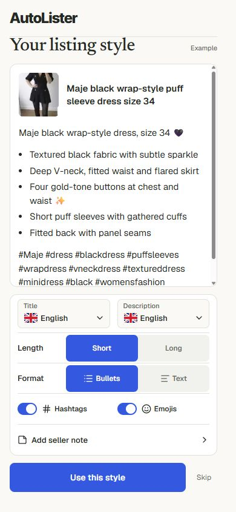

# Listing style setup: release audit, October 15, 2026

The owner approved publishing the reviewed style preview into the real web app after checking the landing-to-value journey. This audit supports that integration. It does not expand the model pilot or change generation prompt text.

## Flow and evidence

| Step               | Result                                                                                                                                                                                                                               | Evidence                                                                                                                                                                                        |
| ------------------ | ------------------------------------------------------------------------------------------------------------------------------------------------------------------------------------------------------------------------------------ | ----------------------------------------------------------------------------------------------------------------------------------------------------------------------------------------------- |
| 1. Mobile landing  | Clear Create a draft action opens the real app. Extension remains a separate alternative.                                                                                                                                            | [Landing](style-onboarding-release-20261015/01-landing.jpg)                                                                                                                                     |
| 2. Sign in         | Google and passwordless email choices render correctly, without browser errors. Existing auth and callback tests pass. No real signup or email was triggered.                                                                        | [Sign in](style-onboarding-release-20261015/02-sign-in.jpg)                                                                                                                                     |
| 3. Choose style    | Compact settings, independent flagged title/description languages, Short default, format and extras update the prepared Maje example. The example scrolls independently. Notes start empty; only Done commits the seller's own text. | [Style](style-onboarding-release-20261015/03-style-initial.jpg)                                                                                                                                 |
| 4. Add photos      | Apply and Skip both open Add item directly. No confirmation screen. Saved choices reach the normal draft workspace. Returning accounts bypass setup and retain saved Long, language and extras choices.                              | [Add item](style-onboarding-release-20261015/04-add-item.jpg)                                                                                                                                   |
| 5. Review and copy | The compiled app prepares two local photos, sends the selected settings to a local API stub, saves its returned draft and copies both fields exactly. No provider call, customer account or marketplace publication is involved.     | [First value](style-onboarding-release-20261015/05-first-value.jpg), [handoff](style-onboarding-release-20261015/handoff-proof.json), [copy](style-onboarding-release-20261015/copy-proof.json) |

## Corrections and safeguards

- Preserve explicit per-account defaults. Fresh web preferences default to Short. Shared backend/extension defaults remain unchanged.
- Offer setup once per browser/account for accounts created from October 15 at 08:37:48 UTC, provided that account has no saved defaults or completion marker. Older accounts retain their existing journey. Browser-local persistence follows the current web settings contract; it does not sync preferences across devices.
- Fix settings merge order so selecting hashtags or emojis off stays off in the actual generation request. Independent English title and Dutch description, Short, bullets, both extras off and a supplied seller note were checked in the outgoing local request.
- A lightweight native dialog replaces the prototype runtime. No React, Radix or animation dependency is added. Prepared copy loads in a separate approximately 11 KB gzip chunk only for eligible setup; the 58 KB source image loads lazily. No AI calls run while changing the example.
- Native modal focus, Escape, outside dismissal, focus restoration, safe-area spacing and background scroll locking are retained. A 240-character note saves; dismissed edits do not. Closing freezes the panel position and moves past the viewport before unmounting, including at a 390 by 260 keyboard-sized viewport.
- Seven measured drawer cycles recorded no long tasks, zero page scrolling and a largest observed frame gap of 42.5 ms, including viewport resize. This is desktop Chromium evidence, not a physical-phone performance guarantee. The final scroll-lock change was additionally checked for overflow restoration and focus return.
- Fixed short-screen clipping in translated headings and made Skip at least 44 pixels wide. All 18 UI languages at 320 by 480 keep the action within view and have no horizontal overflow or visible button below 44 by 44. Also checked 360 by 640, 390 by 844, 430 by 932, 640 by 360, 844 by 390, 768 by 1024 and 1280 by 720. [Locale results](style-onboarding-release-20261015/locale-checks.json), [responsive results](style-onboarding-release-20261015/responsive-checks.json).
- Only two bounded style-setup outcomes are queued through the existing durable transport: shown and complete, with apply/skip and non-content settings. Slider/toggle clicks and seller-note/example text are not logged. Tests verify content exclusion.

## Authentication recommendation

Keep Google plus passwordless email for this release. There is no evidence in this audit that a missing Apple button prevents activation. Apple web sign-in requires separate Services ID, app association and key configuration. It is a useful future option if real sign-in evidence warrants it, not a prerequisite for this browser release. Source: [Apple web setup](https://developer.apple.com/help/account/capabilities/configure-sign-in-with-apple-for-the-web).

## Verification and limits

The full deterministic suite passed 986 tests in 133 files, with three opt-in generation-browser tests skipped. Lint, TypeScript, formatting and a feature-enabled 132-page build passed. The guarded production push runs the full gate again on the release checkout. Local release and deployment evidence is retained under `reports/style-onboarding-release-2026-10-15` in the parent workspace.

Live landing and signed-out UI were captured; authenticated setup, upload, request handoff, saved draft and copying used the actual compiled frontend with local fixtures. Real Google/email authentication, real provider output, live billing, native camera/HEIC, physical iOS/Android keyboards and assistive-technology behavior were not re-enacted. Screenshots do not establish full accessibility compliance. Existing backend/auth/idempotency tests provide regression coverage; no claim of live end-to-end verification follows from them.

